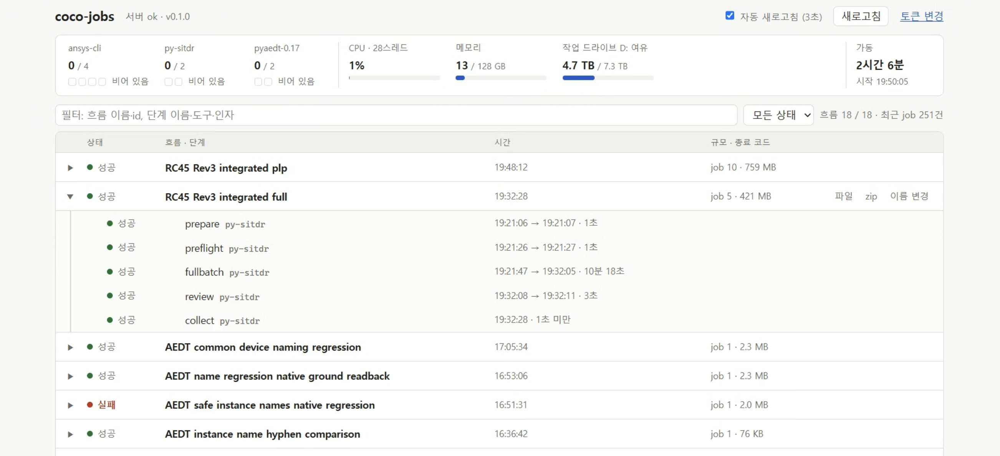

+++
title = '해석을 돌리려다가 Job Scheduler를 만들었습니다'
date = '2026-10-23T00:00:00+09:00'
draft = false
tags = ['AI', 'EDA', '해석자동화', 'JobScheduler']
categories = ['Automation', 'AI']
description = 'SIwave의 3D 옵션을 검토하다가 서버 작업을 관리할 개인용 Job Scheduler를 만들었습니다.'
images = ['coco-jobs-dashboard.png']

[[resources]]
name = 'featured-image-preview'
src = 'coco-jobs-dashboard.png'
+++

최근 해석 자동화를 하면서 SIwave의 3D 옵션을 검토할 일이 있었습니다. 문제는 제 PC의 메모리가 부족하다는 것이었어요. 검토를 진행하려면 메모리가 더 큰 서버에서 해석을 돌려야 했습니다.

AI가 서버 PC에 접속해서 작업하게 하는 것은 크게 어려운 일이 아니었습니다. 그냥 그렇게 진행해도 됐겠지만, 명색이 EDA 솔루션을 만드는 사람이잖아요. 이왕 서버를 사용할 거라면 해석을 의뢰하고 진행 상황과 결과를 확인할 수 있는 시스템을 만들어보기로 했습니다.

## 필요한 만큼 만들어 써보기

예전 같으면 Jenkins 같은 도구를 알아보거나, 그냥 SSH로 서버에 접속해서 실행했을 것 같습니다. 별도의 의뢰 시스템을 만드는 것은 그것대로 일이니까요.

이번에는 AI와 함께 직접 만들었습니다. 이름은 `coco-jobs`라고 붙였어요.

화면에서는 서버의 CPU·메모리·디스크 상태와 도구별 실행 슬롯을 확인할 수 있습니다. 작업은 흐름별로 묶어서 보고, 각 단계의 실행 시간과 성공·실패 여부, 결과 파일도 확인할 수 있게 했습니다.

*개인용으로 만든 coco-jobs 실행 화면입니다. 이미지를 누르면 크게 볼 수 있습니다.*

해석 준비부터 실행, 결과 수집까지 여러 단계가 이어지는 작업을 한곳에서 볼 수 있으니 개인적으로 쓰기에 편했습니다. 스케줄러 구조도 나름 신경 써서 잡았다고 생각하고요.

누군가에게 바로 사용하라고 하기에는 더 다듬어야겠지만, 제가 해석을 검토하고 작업을 돌리는 데는 부족하지 않았습니다.

## 개인용 도구를 만드는 부담이 줄었습니다

이번에 느낀 것은 필요한 도구를 직접 만들어 쓰는 선택이 꽤 가벼워졌다는 점입니다.

원래 하려던 일은 SIwave의 3D 옵션을 검토하는 것이었습니다. 그 과정에서 서버가 필요해졌고, 서버 작업을 관리할 도구까지 만들게 됐어요. 예전이라면 별도 과제로 생각했을 일을, 당장의 작업 환경을 갖추는 과정에서 하게 된 셈입니다.

물론 어떤 작업을 묶고 어떻게 실행할지, 상태와 결과를 어떻게 관리할지는 생각해야 했습니다. 다만 그 생각을 코드와 화면으로 옮기는 데 AI의 도움을 받을 수 있었고, 직접 써보면서 필요한 부분을 다듬을 수 있었어요.

모두에게 제공할 제품을 만들려면 확인할 것이 훨씬 많겠죠. 이번에는 제 작업을 처리하는 데 필요한 범위로 만들고, 실제로 사용해 볼 수 있다는 것으로 충분했습니다.

이렇게 된 김에 해석 작업뿐 아니라 앞으로 서버에서 실행할 작업들을 맡기는 개인용 Job Scheduler로 계속 써보려고 합니다.
